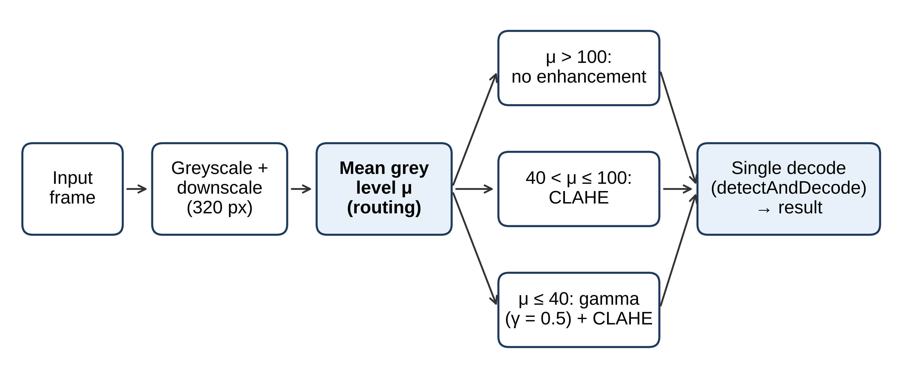

# Brightness-Aware QR Code Detection under Low Light

Code and data for the paper:

> N. Mahmoudian, T. P. Ping, C. S. See. *A Lightweight Brightness-Aware Pipeline for Low-Latency QR Code Detection under Low-Light Conditions.* Submitted to the Journal of Real-Time Image Processing (2026).

The pipeline measures the mean grey level μ of each frame and sends it to exactly one processing path. It then downscales the frame so its longer side is 320 px and decodes it once with `cv2.QRCodeDetector`. It runs on a CPU only and needs no training.



| Mean grey level | Processing |
|---|---|
| μ > 100 | No enhancement |
| 40 < μ ≤ 100 | CLAHE (clip limit 2.0, 8 × 8 tiles) |
| μ ≤ 40 | Gamma (γ = 0.5) + CLAHE |

## Main results

Real captures: 300 images in total (150 of codes on a phone screen, 150 of printed codes). The captures were taken under three lighting conditions: low (10–50 lux), medium (50–100 lux) and high (> 100 lux). Latencies were measured on an Intel Core i7-7500U laptop CPU with 12 GB RAM and no GPU.

| Method | Accuracy (n = 300) | Mean latency |
|---|---|---|
| OpenCV baseline | 99.0% (297/300) | 21.8 ms |
| **Proposed (v2)** | **100.0% (300/300)** | **14.1 ms** |
| WeChat QR (deep learning) | 100.0% (300/300) | 19.1 ms |

Latency distribution on the printed codes (n = 150, ms):

| Method | Mean | Median | 95th percentile | Max |
|---|---|---|---|---|
| OpenCV baseline | 22.0 | 21.7 | 24.5 | 27.6 |
| **Proposed (v2)** | **13.5** | **13.3** | **15.0** | **19.1** |
| WeChat QR | 19.0 | 18.6 | 22.4 | 24.7 |

Latency depends on the CPU. The ranking above was measured on the i7-7500U. On other processors the relative speed of WeChat QR can differ.

## Repository structure

```
src/
  pipelines.py            the three methods (baseline, proposed, WeChat QR)
  evaluate_three_way.py   evaluation on the screen-displayed codes (Group B1)
  evaluate_paper.py       evaluation on the printed codes (Group B2)
  capture_and_decode.py   live camera tool used to capture the images
  generate_qr.py          generates the QR codes
data/
  qr_codes/               the 150 generated QR codes (EVENT2026-0001 ... 0150)
  dataset_B1_screen/      150 captures of codes shown on a phone screen (low / medium / high)
  dataset_B2_printed/     150 captures of printed codes (low / medium / high)
  ground_truth_screen.csv     ground truth for B1 (filename, ground_truth)
  ground_truth_paper_ALL.csv  ground truth for B2 (filename, ground_truth)
  screen_dataset_ALL.csv      capture log for B1 (condition, timestamp, latency at capture)
  qr_metadata.csv             content of every generated code
results/
  paper/                  per-image results of the three methods on B2
  screen/                 per-image results of the three methods on B1
models/                   WeChat QR model files (third party, see models/SOURCE.md)
figures/                  figures used in the paper
```

The captures use the 50 codes EVENT2026-0101 to EVENT2026-0150, each captured once in each lighting condition. Three screen captures, one in each condition, show code EVENT2026-0001 or EVENT2026-0050 instead.

## Installation

```bash
git clone https://github.com/<your-username>/qr-lowlight-routing.git
cd qr-lowlight-routing
pip install -r requirements.txt
```

## Reproducing the results

Run these from the repository root:

```bash
python src/evaluate_three_way.py   # Group B1, screen-displayed codes
python src/evaluate_paper.py       # Group B2, printed codes
```

Each script prints accuracy, false-positive rate and mean latency per condition. It also writes per-image results to `results/`. Running a script overwrites the stored results file with latencies from your own machine.

## Data

- Illuminance was measured at the code surface with [lux meter / app name].
- Images are PNG frames from the laptop's built-in camera, 640 × 480 px (two images are slightly cropped).

## Citation

If you use this code or data, please cite the paper (see `CITATION.cff`).

## License

- Code: MIT License (`LICENSE`)
- Captured images and CSV files in `data/`: CC BY 4.0 (`data/LICENSE`)
- `models/`: third-party files, see `models/SOURCE.md`
